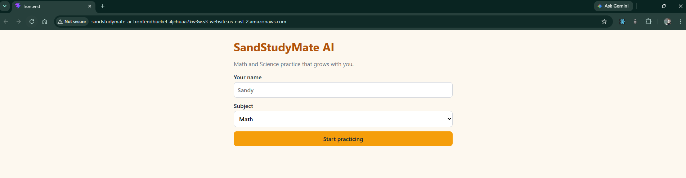

# SandStudyMate AI

An adaptive Math and Science practice tutor for 5th graders. A child picks a subject or types any topic
("percentages", "deep space"), and gets multiple-choice questions grounded in curated study notes.
Questions get harder after two right answers in a row and easier after two misses.

**Live demo:** http://sandstudymate-ai-frontendbucket-4jchuaa7kw3w.s3-website.us-east-2.amazonaws.com

## Architecture

React + TypeScript (S3 static site) → API Gateway HTTP API → one Python 3.12 Lambda →
DynamoDB (sessions) + S3 (RAG index) + Amazon Bedrock: Nova Micro routes free text, Titan V2 embeddings
retrieve study notes, Claude Haiku writes the question, Bedrock Guardrails check input and output.
Deployed with AWS SAM in us-east-2; X-Ray tracing on.

## Highlights

- Adaptive difficulty engine (5 levels, streak-based)
- RAG over 31 hand-written study notes; questions labelled "from study notes" when grounded
- Child safety: guardrails on the child's message and on every generated question
- Answer key never sent to the browser; sessions expire after 7 days (DynamoDB TTL)
- Model output schema-validated, one retry; notes-based rescue when the router misjudges a topic
- Golden-set evals with an LLM judge; live cost and latency metrics

## Results

| Metric | Value |
| --- | --- |
| Unit tests | 30 passing |
| Retrieval hit@3 / MRR | (Step 6) |
| Eval pass rate / faithfulness | (Step 6) |
| Cost per question, p95 latency | (Step 6) |

## Run it yourself

1. Backend: Python 3.12 venv in `backend/`, `pip install -r requirements-dev.txt`, `pytest -v` from the repo root,
   then `sam build` and `sam deploy --guided` in `backend/`.
2. Frontend: in `frontend/`, `npm install`, copy `.env.example` to `.env.local` with your ApiUrl, `npm run dev`.

## Known limits

No login (anonymous sessions by design); CORS currently allows all origins; throttled at 5 requests/second.
