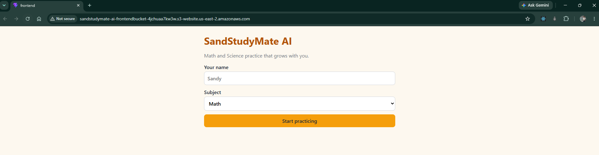

# SandStudyMate AI

# SandStudyMate AI

An adaptive Math and Science practice chatbot for 5th graders. Questions are written on the fly by Claude on Amazon Bedrock and get harder after two correct answers in a row (easier after two misses).

**Live demo:** (http://sandstudymate-ai-frontendbucket-4jchuaa7kw3w.s3-website.us-east-2.amazonaws.com)

## Architecture

React + TypeScript (S3 static site) → API Gateway HTTP API → AWS Lambda (Python 3.12) → Amazon Bedrock for question generation and DynamoDB for session state. Everything is defined as infrastructure as code with AWS SAM.

## Highlights

- Adaptive difficulty engine (5 levels, streak-based), fully unit tested with pytest
- LLM output validated server-side before use; one automatic retry on malformed output
- Correct answers never sent to the browser; sessions expire automatically via DynamoDB TTL
- API throttling and CORS restricted to known origins

## Run it yourself

1. Backend: in backend/, create a Python 3.12 venv, `pip install -r requirements-dev.txt`, run `pytest`, then `sam build` and `sam deploy --guided`.
2. Frontend: in frontend/, `npm install`, copy .env.example to .env.local with your ApiUrl, `npm run dev`.

## Tech

AWS Lambda, API Gateway, DynamoDB, S3, Amazon Bedrock, AWS SAM, Python, React, TypeScript, Vite.
